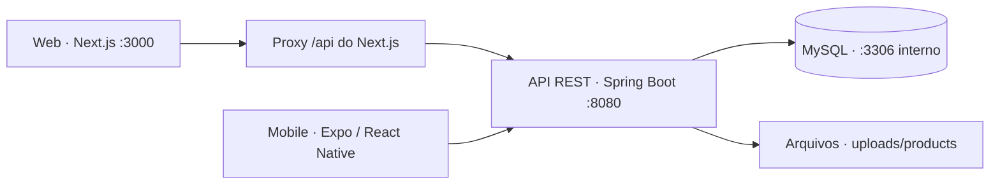

# 🚀 Catapult

**Catálogo de produtos e gestão de estoque, com interface web e aplicativo mobile.**


## 📑 Sumário

- [Sobre o projeto](#-sobre-o-projeto)
- [Funcionalidades](#-funcionalidades)
- [Tecnologias utilizadas](#-tecnologias-utilizadas)
- [Arquitetura e processos](#-arquitetura-e-processos)
- [Estrutura do repositório](#-estrutura-do-repositório)
- [Pré-requisitos](#-pré-requisitos)
- [Execução com containers](#-execução-com-containers)
- [Execução local](#-execução-local)
- [Aplicativo mobile](#-aplicativo-mobile)
- [Configurações](#-configurações)
- [API e autenticação](#-api-e-autenticação)
- [Verificações e testes](#-verificações-e-testes)
- [Problemas comuns](#-problemas-comuns)
- [Documentação complementar](#-documentação-complementar)

## 💡 Sobre o projeto

O Catapult integra a consulta de produtos com a administração de um catálogo e de seu estoque. O visitante pode explorar a vitrine, consultar produtos, montar uma sacola e finalizar a compra. A área administrativa permite organizar categorias, cadastrar produtos, ajustar quantidades e acompanhar indicadores do catálogo.

A aplicação possui três módulos: uma **API REST em Java/Spring Boot**, um **frontend web em Next.js** e um **aplicativo em Expo/React Native**. Web e mobile consomem a mesma API e compartilham os dados armazenados no banco.

A finalização da compra calcula o total e registra a baixa de estoque. **Não há integração com meios de pagamento ou cobrança online.**

## ✨ Funcionalidades

| Área | Recursos |
| --- | --- |
| 🛍️ Catálogo público | Consulta de produtos e categorias, busca, filtros, paginação e detalhes de produtos. |
| 🛒 Sacola | Inclusão e remoção de itens, alteração de quantidades e persistência local. |
| ✅ Checkout | Cálculo de valores no servidor, validação de disponibilidade e baixa de todos os itens em uma transação. |
| 🔐 Administração | Login, verificação de sessão, logout e proteção das operações administrativas. |
| 📦 Produtos | Cadastro, edição, exclusão, preço de venda, custo, categoria, situação ativa/inativa e ajuste de estoque. |
| 🗂️ Categorias | Cadastro, consulta, edição e exclusão; categorias com produtos vinculados não podem ser excluídas. |
| 🖼️ Arquivos | Envio de imagens e PDFs associados aos produtos. |
| 📊 Dashboard | Totais de produtos e categorias, valor do estoque, preço médio, estoque baixo, produtos sem foto e agrupamentos. |
| 📱 Mobile | Catálogo, sacola, checkout e telas administrativas para Android/iOS, com temas claro, escuro e do sistema. |

## 🧰 Tecnologias utilizadas

As versões abaixo correspondem às declarações nos arquivos `pom.xml` e `package.json` do repositório.

### ☕ Backend

| Tecnologia | Versão / configuração | Uso no projeto |
| --- | --- | --- |
| Java | 21 | Linguagem da API. |
| Spring Boot | 4.1.1 | Inicialização, configuração e integração dos componentes. |
| Spring MVC | Gerenciada pelo Spring Boot | Endpoints REST, JSON e requisições multipart para arquivos. |
| Spring Security | Gerenciada pelo Spring Boot | Autenticação por sessão HTTP, autorização e senhas com BCrypt. |
| Spring Data JPA / Hibernate | Gerenciadas pelo Spring Boot | Persistência, consultas, paginação e filtros com Specifications. |
| Jakarta Validation | Via starter de validação | Validação dos dados de entrada dos endpoints. |
| MySQL / Connector/J | MySQL 8.4 no Compose | Banco relacional e driver JDBC. A configuração de desenvolvimento também contempla MariaDB. |
| Flyway | Com suporte a MySQL | Migrações versionadas do esquema do banco. |
| Lombok | 1.18.48 | Redução de código repetitivo nas classes Java. |
| Datafaker | 2.4.2 | Geração de dados de demonstração no perfil `dev`. |
| Maven Wrapper | Maven 3.9.16 | Execução, testes e empacotamento sem instalar Maven separadamente. |
| JUnit / Spring Boot Test / MockMvc | Dependências de teste do Spring | Testes de contexto e integração da API e do checkout. |

### 🌐 Frontend web

| Tecnologia | Versão declarada | Uso no projeto |
| --- | --- | --- |
| Next.js | 16.4.3 | Interface web com App Router e encaminhamento de `/api` para o backend. |
| React / React DOM | 19.3.0 | Componentes, estado e interação das telas. |
| TypeScript | 5.x | Tipagem de componentes, formulários e contratos da API. |
| Tailwind CSS | 4.x | Estilização, com integração ao Turbopack. |
| TanStack Query | ^5.105.0 | Consultas, cache, mutations e atualização dos dados após alterações. |
| React Hook Form | ^7.91.0 | Controle de formulários. |
| Zod / Hook Form Resolvers | ^4.6.7 / ^6.0.0 | Validação e integração dos esquemas com formulários. |
| Fetch API / localStorage | APIs do navegador | Comunicação com cookies de sessão e persistência da sacola e de tentativas de checkout. |
| ESLint | 9.x | Análise estática do código. |

### 📱 Mobile

| Tecnologia | Versão declarada | Uso no projeto |
| --- | --- | --- |
| Expo | ~58.0.22 | Ambiente de desenvolvimento e execução do aplicativo. |
| React Native / React | 0.88.1 / 19.3.0 | Interface nativa e componentes. |
| TypeScript | ~6.0.3 | Tipagem das telas e da integração com a API. |
| Expo Router | ~58.0.29 | Navegação baseada em arquivos, layouts e abas administrativas. |
| TanStack Query | ^5.105.0 | Consultas, paginação, cache e atualização de dados. |
| AsyncStorage | 2.2.0 | Persistência da sacola, tentativa de checkout e preferência de tema. |
| Expo Document Picker / Expo Image | SDK 58 | Seleção de arquivos e exibição de imagens. |
| Expo Crypto | ~58.0.7 | Geração de identificadores para as tentativas de checkout. |
| Expo Vector Icons | ^15.0.2 | Ícones da interface. |
| Gesture Handler / Reanimated | ~3.3.0 / 4.7.1 | Infraestrutura de gestos e animações. |
| Fetch / whatwg-fetch | Nativo / ^3.6.20 | Requisições com sessão e envio de arquivos nativos em multipart. |
| ESLint / Expo ESLint Config | 9.x / SDK 58 | Análise estática do aplicativo. |

### 📦 Infraestrutura e ferramentas

- **Podman + podman-compose:** execução conjunta de banco, API e frontend pelo `compose.yaml`.
- **Containerfiles com múltiplos estágios:** compilação Java com Maven/Temurin 21 e build web com Node.js 22 Alpine; as imagens finais executam o JAR e o servidor Next.js.
- **Volumes:** persistência do banco e dos arquivos enviados, independente da recriação dos containers.
- **Healthcheck do MySQL:** o backend depende de o banco estar saudável para ser iniciado pelo Compose.
- **Bruno:** coleção versionada para testar manualmente os endpoints.
- **npm e arquivos de lock:** instalação das dependências de web e mobile com `npm ci`.

## 🏗️ Arquitetura e processos



### Organização do backend

O fluxo principal é `Spring Security → Controller → Service → Repository → banco`. Os controllers recebem as requisições e validam DTOs; os services executam as regras de negócio; os repositories usam JPA para acessar as entidades. O serviço de armazenamento cuida dos arquivos de produtos.

O Flyway aplica as migrações de categorias, produtos, usuários e comprovantes de checkout. O Hibernate está configurado com `ddl-auto=validate`: ele confere a estrutura criada pelas migrações.

### Autenticação e integração dos clientes

O login cria uma sessão HTTP identificada pelo cookie `JSESSIONID`. As senhas são armazenadas com BCrypt. Web e mobile enviam as chamadas com `credentials: 'include'` e verificam a sessão antes de exibir a administração. O projeto usa autenticação por cookie, sem JWT.

No navegador, o frontend chama `/api` na própria origem. O Next.js encaminha essas chamadas ao backend por meio de `rewrites`. O aplicativo nativo acessa diretamente o endereço definido em `EXPO_PUBLIC_API_ORIGIN`.

### Consistência do checkout

Cada tentativa tem um UUID em `request_id`. O servidor usa os preços atuais do banco, bloqueia os produtos durante a transação e valida todos os itens antes de concluir a baixa. Se algum produto estiver indisponível, inativo ou sem estoque suficiente, toda a operação é desfeita.

Reenviar o mesmo identificador com os mesmos itens devolve o comprovante original, sem descontar novamente o estoque. Esse processo é chamado de **idempotência** e permite repetir uma tentativa após uma falha de rede.

### Dados de desenvolvimento

O perfil `dev` fica ativo por padrão. Na inicialização, o `DataSeeder` configura o administrador e, se ainda não existir nenhuma categoria, cria **5 categorias e 20 produtos fictícios**, com preços, estoques e imagens de exemplo.

O acesso inicial é **usuário `admin` e senha `admin`**. O seeder reaplica a senha configurada ao iniciar o perfil `dev`. As credenciais e os dados de demonstração são destinados ao desenvolvimento.

## 🗂️ Estrutura do repositório

```text
Catapult/
├── compose.yaml                 # Banco, backend, frontend e volumes
├── README.md
├── backend/
│   ├── Containerfile
│   ├── pom.xml                  # Dependências e build Java
│   ├── mvnw / mvnw.cmd          # Maven Wrapper
│   ├── bruno/                   # Coleção de requisições
│   ├── docs/                    # Contratos da API e checkout
│   └── src/
│       ├── main/java/japa/project/
│       │   ├── config/          # Segurança
│       │   ├── controller/      # Endpoints REST
│       │   ├── dto/             # Dados de entrada e saída
│       │   ├── entity/          # Entidades JPA
│       │   ├── factory/         # Dados fictícios
│       │   ├── repository/      # Acesso ao banco
│       │   ├── seeder/          # Inicialização de desenvolvimento
│       │   └── service/         # Regras de negócio e arquivos
│       ├── main/resources/      # Configuração, migrações e imagem padrão
│       └── test/                # Testes de integração
├── frontend/
│   ├── Containerfile
│   ├── app/                     # Rotas públicas, login e administração
│   ├── components/              # Componentes compartilhados
│   ├── features/                # Catálogo, sacola, autenticação e gestão
│   └── lib/                     # Cliente da API, tipos e utilitários
└── mobile/
    ├── .env.example             # Modelo do endereço da API
    ├── app.json                 # Configuração Expo
    ├── docs/                    # API, mobile e paridade visual/funcional
    └── src/
        ├── app/                 # Rotas Expo Router
        ├── components/          # Componentes e formulários
        ├── lib/api/             # Cliente HTTP, serviços e tipos
        ├── providers/           # Sessão, consultas, sacola e tema
        └── theme/               # Cores e tokens de interface
```

## ✅ Pré-requisitos

Escolha como deseja executar:

| Forma de execução | O que instalar |
| --- | --- |
| Web + API + banco em containers | Git, Podman e `podman-compose`; alternativamente, Docker Engine com Compose v2. |
| Backend local | JDK 21, MySQL 8.4 ou MariaDB compatível e acesso à internet na primeira execução do Maven Wrapper. |
| Frontend local | Node.js 22, a partir de **22.13.0**, e npm. |
| Mobile | Node.js 22, a partir de **22.13.0**, npm e Expo Go compatível com o SDK 58, ou ambiente nativo compatível. |
| Emuladores | Android Studio/Android SDK para Android; macOS com Xcode para o simulador iOS. |

A linha Node.js 22 atende aos módulos web e mobile e é usada no container web. Para usar somente o Compose, não é necessário instalar Java, Node.js ou MySQL no computador. O mobile roda separadamente dos containers e precisa de Node.js.

Os comandos abaixo usam Bash em Linux/macOS. No Windows, adapte as variáveis de ambiente ao terminal e use `mvnw.cmd` no lugar de `./mvnw`.

Clone o repositório e entre na pasta:

```bash
git clone https://github.com/Am4raIl/catapult.git Catapult
cd Catapult
```

## 📦 Execução com containers

### 1. Iniciar com Podman

Na raiz do repositório:

```bash
podman-compose up --build --force-recreate -d
```

O comando constrói as imagens e inicia MySQL, backend e frontend. O banco `project` é criado automaticamente; a API aplica as migrações e prepara os dados de demonstração. A primeira execução pode levar alguns minutos para baixar dependências e imagens.

### 2. Acessar

| Serviço | Endereço |
| --- | --- |
| Vitrine web | http://localhost:3000 |
| Login administrativo | http://localhost:3000/login |
| Painel administrativo | http://localhost:3000/admin |
| API | http://localhost:8080/api |
| Consulta pública para conferir a API | http://localhost:8080/api/products |

Entre com `admin` / `admin`. O MySQL é acessível pela rede interna dos containers em `db:3306`; a porta do banco não é publicada no computador.

### 3. Comandos do dia a dia

```bash
# Iniciar os serviços já construídos
podman-compose up -d

# Consultar o estado dos containers
podman-compose ps

# Acompanhar todos os logs; Ctrl+C encerra o acompanhamento
podman-compose logs -f

# Acompanhar apenas a API
podman-compose logs -f backend

# Reconstruir após alterações no backend ou frontend
podman-compose up --build --force-recreate -d

# Parar e remover os containers, mantendo os volumes
podman-compose down
```

O Compose não monta o código-fonte nem ativa recarga automática. Depois de editar o código, reconstrua as imagens. Para desenvolvimento com recarga, use a execução local.

Os volumes `mysql-data` e `product-uploads` preservam o banco e os arquivos mesmo após `down` e recriação dos containers. **`podman-compose down -v` também apaga esses volumes e seus dados.**

### Alternativa: Docker Compose

Os arquivos de build do projeto se chamam `Containerfile`. Para indicar esse nome explicitamente ao Docker Compose, execute na raiz, em Bash:

```bash
docker compose -f compose.yaml -f - up --build -d <<'YAML'
services:
  backend:
    build:
      context: ./backend
      dockerfile: Containerfile
  frontend:
    build:
      context: ./frontend
      dockerfile: Containerfile
YAML
```

Esse comando usa uma configuração complementar pela entrada padrão, sem criar outro arquivo. Repita-o quando precisar reconstruir. Para consultar logs ou parar os serviços, use `docker compose logs -f`, `docker compose ps` e `docker compose down`.

## 💻 Execução local

Nesta opção, banco, API e frontend rodam diretamente no computador. Os comandos de cada etapa partem da raiz `Catapult/`, em terminais separados.

### 1. Preparar o banco

Com MySQL/MariaDB iniciado, abra o cliente:

```bash
mysql -u root -p
```

Crie o banco vazio:

```sql
CREATE DATABASE IF NOT EXISTS project CHARACTER SET utf8mb4;
EXIT;
```

As tabelas serão criadas pelo Flyway ao iniciar o backend. O usuário configurado precisa ter permissão para aplicar as migrações nesse banco.

### 2. Iniciar o backend

A configuração versionada de desenvolvimento usa `localhost:3306`, banco `project`, usuário `root` e senha `1234`. Para usar suas credenciais sem editar o arquivo, informe as variáveis no comando:

```bash
cd backend
SPRING_DATASOURCE_URL='jdbc:mysql://localhost:3306/project' \
SPRING_DATASOURCE_USERNAME='root' \
SPRING_DATASOURCE_PASSWORD='SUA_SENHA_DO_BANCO' \
./mvnw spring-boot:run
```

Substitua os valores conforme sua instalação. Se ela já usa os valores versionados, basta executar `./mvnw spring-boot:run` dentro de `backend/`.

A API ficará em `http://localhost:8080/api`. Mantenha o terminal aberto. Para conferir a inicialização:

```bash
curl 'http://localhost:8080/api/products?page=0&size=2'
```

### 3. Iniciar o frontend

Em outro terminal, a partir da raiz:

```bash
cd frontend
npm ci
npm run dev
```

Abra http://localhost:3000. O proxy do Next.js usa `http://localhost:8080` como destino padrão para `/api`, sem exigir arquivo `.env` para essa configuração.

Se a API estiver em outro endereço, inicie com:

```bash
API_ORIGIN=http://ENDERECO_DA_API:8080 npm run dev
```

### 4. Gerar os artefatos localmente

Para empacotar o backend sem executar testes de integração:

```bash
cd backend
./mvnw -DskipTests package
java -jar target/project-0.0.1-SNAPSHOT.jar
```

O JAR precisa do banco e das mesmas configurações de conexão usadas no desenvolvimento. Se as credenciais diferirem dos padrões, informe as variáveis também ao executar `java -jar`.

Para construir e iniciar o frontend no modo de produção do Next.js, em outro terminal a partir da raiz:

```bash
cd frontend
npm ci
npm run build
npm run start
```

Defina `API_ORIGIN` antes do build se o backend estiver em outro endereço, pois os rewrites são definidos durante a construção. O build do frontend também utiliza `next/font` para obter as fontes do Google e precisa de acesso a esse serviço.

## 📱 Aplicativo mobile

A API deve estar em execução, localmente ou em container. O frontend Next.js não precisa estar iniciado para usar o aplicativo nativo.

### 1. Instalar e configurar

A partir da raiz:

```bash
cd mobile
npm ci
cp .env.example .env.local
```

Se já existir `.env.local`, edite o arquivo existente. Configure `EXPO_PUBLIC_API_ORIGIN` conforme o dispositivo:

| Ambiente | Valor no `.env.local` |
| --- | --- |
| Telefone físico | `EXPO_PUBLIC_API_ORIGIN=http://SEU_IP_LOCAL:8080` |
| Android Emulator padrão | `EXPO_PUBLIC_API_ORIGIN=http://10.0.2.2:8080` |
| iOS Simulator no mesmo Mac da API | `EXPO_PUBLIC_API_ORIGIN=http://127.0.0.1:8080` |

Use apenas a origem, **sem `/api` no final**: o cliente adiciona esse prefixo. Reinicie o Expo após mudar a variável.

### 2. Liberar a API para um telefone físico

No telefone, `localhost` aponta para o próprio celular. Use o IP do computador e mantenha ambos em uma rede que permita comunicação entre os dispositivos.

No Linux, encontre o IP no campo `src` da saída:

```bash
ip -4 route get 1.1.1.1
```

Se a API estiver no Podman, publique-a nesse IP. Na raiz do repositório, substitua `SEU_IP_LOCAL` pelo endereço real:

```bash
CATAPULT_API_BIND=SEU_IP_LOCAL podman-compose up --build --force-recreate -d db backend
```

Por padrão, o Compose publica a API apenas em `127.0.0.1`. Repita `CATAPULT_API_BIND` nos próximos comandos `up` para manter o acesso pelo celular. Se usar Docker, exporte a variável e execute o comando da alternativa Docker Compose.

Se a API estiver rodando diretamente com Maven, confira se a porta `8080` está acessível pela rede e permitida no firewall. Abra `http://SEU_IP_LOCAL:8080/api/products` no navegador do telefone para conferir a conexão.

### 3. Iniciar o Expo

Dentro de `mobile/`:

```bash
npx expo start --lan --clear
```

Escaneie o QR code com o Expo Go no Android ou com a câmera no iPhone. Mantenha o terminal aberto durante o uso.

Para abrir em um emulador já configurado, também estão disponíveis:

```bash
npm run android
npm run ios
```

O simulador iOS requer macOS e Xcode. Se o Expo Go instalado não suportar o SDK 58, use uma versão compatível ou um development build correspondente ao projeto.

O script `npm run web` inicia a variante web do Expo. A API atual não configura CORS; para consumir a API pelo navegador nessa variante, é necessário configurar CORS no servidor ou um proxy de mesma origem. O frontend web principal do projeto é o módulo `frontend/`.

Para redes que impedem conexão direta e alternativas com túneis, consulte o [guia adicional do mobile](mobile/docs.md).

## ⚙️ Configurações

| Variável / propriedade | Padrão ou exemplo | Finalidade |
| --- | --- | --- |
| `SPRING_PROFILES_ACTIVE` | `dev` | Perfil ativo da API; no Compose é definido explicitamente. |
| `SPRING_DATASOURCE_URL` | Local: `jdbc:mysql://localhost:3306/project` | Endereço JDBC do banco. No Compose usa o serviço `db`. |
| `SPRING_DATASOURCE_USERNAME` | Local: `root`; Compose: `catapult` | Usuário do banco. |
| `SPRING_DATASOURCE_PASSWORD` | Local: `1234`; Compose: `catapult` | Senha do banco de desenvolvimento. |
| `APP_DEFAULT_ADMIN_USERNAME` | `admin` | Nome do administrador configurado pelo seeder `dev`. |
| `APP_DEFAULT_ADMIN_PASSWORD` | `admin` | Senha reaplicada ao administrador pelo seeder `dev`. |
| `APP_STORAGE_PRODUCTS_DIR` | `uploads/products` | Pasta dos arquivos, relativa ao diretório de execução da API. |
| `API_ORIGIN` | Local: `http://localhost:8080` | Destino do proxy Next.js; no Containerfile é `http://backend:8080`. |
| `EXPO_PUBLIC_API_ORIGIN` | `http://SEU_IP_LOCAL:8080` | Origem da API usada pelo aplicativo Expo. |
| `CATAPULT_API_BIND` | `127.0.0.1` | Interface do computador na qual o Compose publica a porta `8080`. |

As variáveis `SPRING_*` e `APP_*` são lidas pelo processo Java. Para alterá-las nos containers, passe-as em `environment` do serviço `backend` ou em uma configuração complementar do Compose. Exportá-las no terminal, por si só, não substitui os valores fixos do `compose.yaml`.

A persistência local de arquivos fica em `backend/uploads/products` ao executar a API de dentro de `backend/`. No container, fica em `/app/uploads/products`, dentro do volume de uploads. O banco guarda a referência ao arquivo; preserve **banco e uploads** para manter o catálogo completo.

## 🔌 API e autenticação

Prefixo: `/api`. A tabela resume os principais recursos; os contratos completos estão na documentação do backend.

| Método | Rota | Acesso / finalidade |
| --- | --- | --- |
| `POST` | `/api/login` | Público; inicia sessão com usuário e senha. |
| `POST` | `/api/logout` | Encerra a sessão. |
| `GET` | `/api/auth/check` | Autenticado; consulta a sessão atual. |
| `GET` | `/api/products` e `/api/products/{id}` | Público; lista paginada e detalhes. |
| `POST`, `PUT`, `DELETE` | `/api/products` ou `/api/products/{id}` | Autenticado; cria, edita ou exclui produtos. |
| `PATCH` | `/api/products/{id}/stock` | Autenticado; ajusta o estoque. |
| `GET` | `/api/products/{id}/photo` | Público; retorna a imagem ou PDF do produto. |
| `GET` | `/api/categories` e `/api/categories/{id}` | Público; consulta categorias. |
| `POST`, `PUT`, `DELETE` | `/api/categories` ou `/api/categories/{id}` | Autenticado; gerencia categorias. |
| `GET` | `/api/dashboard/summary` | Autenticado; indicadores gerais. |
| `GET` | `/api/dashboard/products-by-category` | Autenticado; agrupamento por categoria. |
| `GET` | `/api/dashboard/price-ranges` | Autenticado; distribuição por faixa de preço. |
| `POST` | `/api/checkout` | Público; confirma a sacola e baixa o estoque. |

Exemplo de login e acesso autenticado pelo terminal:

```bash
curl -i -c /tmp/catapult-cookies.txt \
  -H 'Content-Type: application/json' \
  -d '{"username":"admin","password":"admin"}' \
  http://localhost:8080/api/login

curl -b /tmp/catapult-cookies.txt \
  http://localhost:8080/api/dashboard/summary
```

A listagem de produtos aceita busca por `nome`, categoria (`category_id`), limites de preço, presença de foto, situação de estoque e filtro `active`, além de `page`, `size` e `sort`. A primeira página é `0`.

Uploads aceitam PNG, JPG/JPEG, GIF, WebP e PDF, com limite de **5 MB por arquivo** e **6 MB por requisição**. A API não fornece Swagger/OpenAPI; use os documentos e a coleção Bruno do repositório.

## 🧪 Verificações e testes

### Frontend

Dentro de `frontend/`, com dependências instaladas:

```bash
npm run lint
npx tsc --noEmit
npm run build
```

### Mobile

Dentro de `mobile/`, com dependências instaladas:

```bash
npm run lint
npx tsc --noEmit
npx expo-doctor
```

### Backend

Os testes de integração usam bancos reais e configurações específicas definidas nas classes de teste:

| Classe | Banco / conexão esperada |
| --- | --- |
| `ProjectApplicationTests` | `project_context_test_5`, `localhost:3306`, `root` / `1234`. |
| `ApiIntegrationTests` | `project_api_test_5`, `localhost:3306`, `root` / `1234`. |
| `CheckoutIntegrationTests` | `catapult_checkout_test`, `127.0.0.1:13316`, `root` / `catapult-checkout-test`. |

Use instâncias e bancos descartáveis: os testes de API e checkout limpam registros de suas tabelas. O usuário de teste precisa poder criar os bancos, pois as URLs usam `createDatabaseIfNotExist=true`. O banco do Compose principal não publica a porta `3306` e não atende diretamente a essas conexões.

Após preparar todas as conexões acima, execute dentro de `backend/`:

```bash
./mvnw test
```

Para executar somente os testes de checkout, você pode criar uma instância isolada com Podman:

```bash
podman run -d --name catapult-checkout-db \
  -p 127.0.0.1:13316:3306 \
  -e MYSQL_ROOT_PASSWORD=catapult-checkout-test \
  -e MYSQL_ROOT_HOST=% \
  docker.io/library/mysql:8.4

# Aguarde o MySQL informar que está pronto para conexões
podman logs -f catapult-checkout-db
```

Saia do acompanhamento com `Ctrl+C` e, dentro de `backend/`, execute:

```bash
./mvnw -Dtest=CheckoutIntegrationTests test
```

`CHECKOUT_TEST_DB_URL` permite substituir a URL desse banco de testes. Usuário e senha continuam definidos na classe. Os cenários cobrem validação, rollback, concorrência, repetição da mesma tentativa e filtro de produtos ativos.

Para remover a instância descartável ao terminar:

```bash
podman rm -f -v catapult-checkout-db
```

Para testes manuais da API, abra `backend/bruno/` no Bruno, use `http://localhost:8080/api` como `base_url` e envie `User/Login` antes das requisições protegidas.

## 🛠️ Problemas comuns

| Sintoma | O que conferir |
| --- | --- |
| Backend não conecta ao banco | Serviço do banco iniciado, banco `project` existente e URL/usuário/senha corretos. No Compose, consulte `podman-compose logs db backend`. |
| Web abre, mas os dados não carregam | API em execução e destino `API_ORIGIN` correto. A raiz `/api` não é uma página de status; teste `/api/products`. |
| Celular não conecta | IP real do computador no `.env.local`, rede acessível, porta `8080` liberada e `CATAPULT_API_BIND` definido quando usar containers. |
| Configuração do mobile parece não mudar | Reinicie com `npx expo start --lan --clear` depois de editar `.env.local`. |
| Erro de CORS no Expo Web | Configure proxy de mesma origem ou CORS no backend; para o fluxo nativo, execute Android/iOS. |
| Administração retorna `401` | Faça login novamente. As sessões ficam em memória e são perdidas ao reiniciar a API. |
| Mudança no código não aparece no container | Reconstrua com `podman-compose up --build --force-recreate -d`. |
| Porta `3000` ou `8080` ocupada | Pare a instância anterior antes de alternar entre execução local e containers. |
| Não foram gerados produtos fictícios | O seeder só cria o catálogo de exemplo quando não existe nenhuma categoria. |
| Upload falha | Confira extensão, tipo, limite de tamanho e permissão de escrita na pasta de uploads. |
| Testes falham por conexão | Prepare os bancos de teste nas portas e com as credenciais indicadas; o build dos containers não executa esses testes. |

## 📚 Documentação complementar

- [Contrato detalhado da API](backend/docs/api.md)
- [Checkout: transações, idempotência e testes](backend/docs/checkout.md)
- [Coleção Bruno e testes manuais](backend/bruno/README.md)
- [Execução e configuração do mobile](mobile/README.md)
- [Conexão mobile e alternativas de rede](mobile/docs.md)
- [Integração mobile com a API](mobile/docs/api.md)
- [Paridade do mobile com a interface web](mobile/docs/mobile-parity.md)
- [Design do frontend](frontend/docs/design.md)
